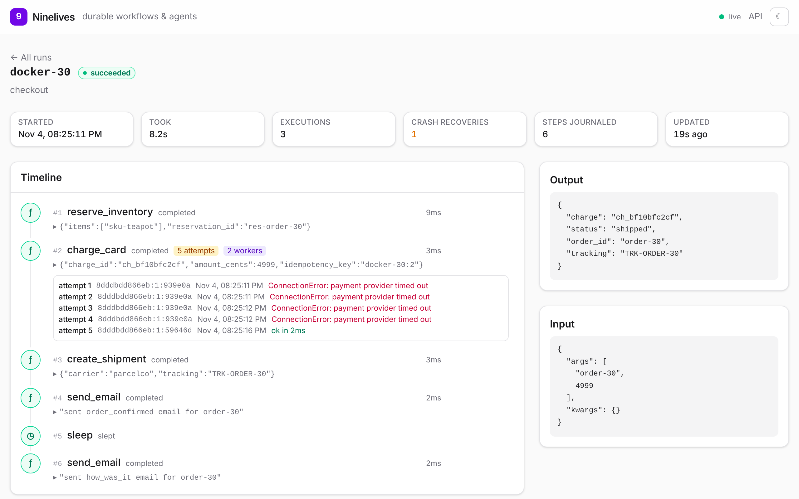
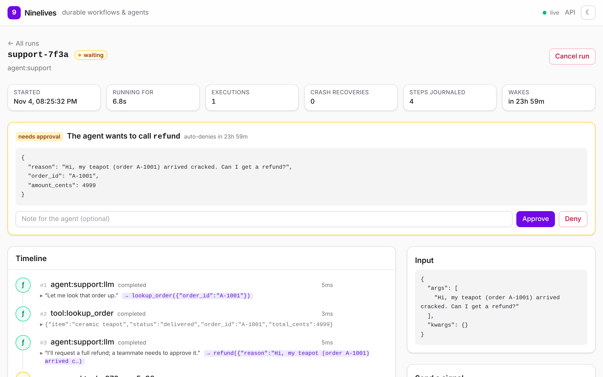

# Ninelives

**Durable execution for Python workflows and AI agents.** Write ordinary `async` Python. Ninelives
journals every step in Postgres or SQLite, so when a worker is killed mid-run (`kill -9`, an OOM, a
deploy) another worker resumes from the last finished step. Finished steps are never re-run, paid
LLM calls are never repeated, and every side effect gets an idempotency key.

[](https://github.com/sunilsk17/Ninelives/actions/workflows/ci.yml)




*Above: a checkout whose payment call failed four times. Its worker was then SIGKILLed, and a second
worker resumed it: the retry budget carried over, and the earlier steps were not repeated.*

```python
from ninelives import Ninelives, step_info

app = Ninelives("postgresql://localhost/app")  # or "sqlite:///app.db"


@app.step()
async def charge_card(order_id: str, cents: int) -> str:
    return await payments.charge(order_id, cents, idempotency_key=step_info().idempotency_key)


@app.workflow()
async def checkout(ctx, order_id: str, cents: int) -> dict:
    charge = await charge_card(order_id, cents)  # retried with backoff, journaled once
    await ctx.sleep(24 * 3600)  # durable: no process waits for a day
    feedback = await ctx.wait_for_signal("review", timeout=7 * 24 * 3600)
    return {"charge": charge, "feedback": feedback}
```

## Why

Long-running work fails halfway: a deploy restarts the box, a container hits its memory limit, a
payment API times out, or an agent's 40th LLM call errors after $3 of tokens. The usual fixes are a
queue, a status column, retries, and a pile of "where was I?" code. Ninelives replaces that with one
idea from Temporal and DBOS: **journal each step, and on restart replay the journal instead of
redoing the work.** It is a single Python package with no extra service; you bring a database.

## Features

- **Steps with retries:** exponential backoff with jitter, timeouts, non-retryable errors and `PermanentError`. Attempt counts survive crashes.
- **Durable timers:** `ctx.sleep(...)` for seconds or weeks. Long sleeps free the worker; the run waits in the database.
- **Signals:** `ctx.wait_for_signal(name, timeout)` for human approvals, webhooks and events. Signals sent early are kept; none are lost or delivered twice.
- **Crash recovery with fencing:** leases, heartbeats and a fencing token on every write, so a paused "zombie" worker can never overwrite the worker that replaced it.
- **Exactly-once effects:** steps run at least once, and `step_info().idempotency_key` is stable across retries and crashes. Pass it to the systems you call.
- **Replay-safe concurrency:** `ctx.gather(...)` runs branches in parallel with deterministic replay.
- **Determinism helpers:** `ctx.now()`, `ctx.uuid()`, `ctx.random()`; changed workflow code is detected (`NonDeterminismError`), not silently mis-replayed.
- **Cancel and fork:** cancel any run, or *re-run from step N*: fork a run, keep the steps before N, and execute the rest with your fixed code or prompt.
- **Durable AI agents:** a tool-calling loop where every LLM call and tool call is a journaled step, with human approval for risky tools, budgets, and an Anthropic provider.
- **Dashboard, HTTP API and CLI:** live run list, step timelines with every attempt, approve/deny buttons, signals, cancel and fork.
- **SQLite or Postgres:** both backends pass the same contract and chaos tests.

## Quick start

```bash
git clone https://github.com/sunilsk17/Ninelives && cd Ninelives
uv sync --all-extras                 # or: pip install -e ".[all]"

uv run python examples/hello.py      # press Ctrl+C during the sleep, run it again: it resumes
```

Install into your own project straight from GitHub:

```bash
pip install "ninelives[all] @ git+https://github.com/sunilsk17/Ninelives"
```

The extras are `postgres` (asyncpg), `server` (FastAPI and uvicorn) and `agents` (the Anthropic
SDK). The core engine has no dependencies.

### Run the demo shop with the dashboard

```bash
uv run ninelives serve examples/shop.py:app --worker
# open http://127.0.0.1:8000
```

[`examples/shop.py`](examples/shop.py) contains a checkout with a flaky payment provider, an expense
approval that waits for a manager, and a support agent whose refunds need a human. From another
terminal:

```bash
uv run ninelives start examples/shop.py:app checkout --args '["order-1", 4999]'
uv run ninelives start examples/shop.py:app expense --args '["dana", 1200]' --id expense-dana
uv run ninelives signal examples/shop.py:app expense-dana decision --payload '{"approved": true, "by": "sam"}'
uv run ninelives start examples/shop.py:app agent:support --args '["Please refund order A-1001, it arrived broken"]'
```

The agent uses Claude when `ANTHROPIC_API_KEY` is set, and a scripted stand-in otherwise, so the
demo works offline.

### Docker: Postgres, the API and three workers

```bash
docker compose up --build            # dashboard on http://localhost:8000
docker compose kill -s SIGKILL worker && docker compose up -d worker   # crash every worker; runs resume
```

## Durable agents

```python
from ninelives import step_info
from ninelives.agents import Agent, AnthropicLLM, tool


@tool
def lookup_order(order_id: str) -> dict:
    """Look up an order.

    order_id: the order id, like A-1001
    """
    return db.orders.get(order_id)


@tool(requires_approval=True)
def refund(order_id: str, amount_cents: int) -> dict:
    """Refund an order. A human approves every call."""
    return payments.refund(order_id, amount_cents, idempotency_key=step_info().idempotency_key)


support = Agent(
    app,
    "support",
    llm=AnthropicLLM(),
    tools=[lookup_order, refund],
    system="You are the support agent for a small shop.",
    max_turns=10,
)

run_id = await support.start("My teapot arrived broken, order A-1001")
```

- **Every LLM call and tool call is a step.** If the worker dies after the third tool call, the agent resumes at the fourth: earlier LLM responses come from the journal, so they are not paid for again.
- **Approvals.** `requires_approval` tools pause the run until someone answers. Answer from the dashboard, from the API, or with `support.approve(run_id, call_id)`. Waiting costs nothing, and a timeout counts as a denial.
- **Failures go back to the model.** Denials, unknown tools, bad arguments and failing tools are returned as `is_error` tool results the model can react to.
- **Budgets.** `max_turns` and `max_total_tokens` stop runaway loops. Refusals end the run cleanly.
- **Tool schemas** come from type hints and docstrings.



## How it works

A workflow is an `async` function. Each durable operation (a step, sleep, signal wait or
deterministic value) gets the next sequence number. When a worker runs a workflow it starts from the
top: operations already in the journal return their recorded result instantly, so execution
fast-forwards to the first unfinished one.

Workers claim runs with an expiring lease (`FOR UPDATE SKIP LOCKED` on Postgres, `BEGIN IMMEDIATE`
on SQLite) and heartbeat while they run. Every write checks the lease's fencing token in the same
transaction. When a worker dies, its lease expires and another worker replays the run from the
journal.

| Guarantee | Meaning |
| --- | --- |
| Workflow code | Re-executed on every resume; must be deterministic (use steps and `ctx.*` helpers for I/O, time and randomness) |
| Steps | At least once. A step re-runs only if its worker dies after the step's side effect and before the journal write |
| Side effects | Exactly once when the external system honours `step_info().idempotency_key` |
| Signals | Delivered exactly once, in order |
| Retries | `max_attempts` is respected across crashes |

The full design (data model, replay, leases and fencing, agents, limitations) is in
[docs/ARCHITECTURE.md](docs/ARCHITECTURE.md).

## Evidence

- **Test suite:** 198 tests with 96% line coverage of the engine. They run against in-memory SQLite, file SQLite and Postgres 16.
- **Chaos test** ([`tests/test_chaos.py`](tests/test_chaos.py)): four worker processes are `SIGKILL`ed 15 times and frozen (`SIGSTOP`) past their lease while 80 workflows run, on both backends. Every run succeeds and journals have no gaps. Of the 480 side effects, each lands exactly once, even though some step bodies ran twice:

  ```text
  chaos[sqlite]: 15 kills, 2 freezes, 22 recoveries, 4 re-executed step bodies, 480 effects applied exactly once
  chaos[postgresql]: 15 kills, 2 freezes, 25 recoveries, 4 re-executed step bodies, 480 effects applied exactly once
  ```

- **Dashboard:** Playwright tests drive a live server, covering starts, signals, approvals, denials, forks, cancels, filters and the mobile layout.
- **Benchmarks** ([`benchmarks/RESULTS.md`](benchmarks/RESULTS.md)), on a 4-vCPU container:

  | Store | Workflows/s (10 steps each) | Per-step latency | Recovery after `kill -9` (2s lease) |
  |---|---|---|---|
  | SQLite (WAL) | 125 | 0.96 ms | 2.4 s |
  | Postgres 16 | 137 | 3.71 ms | 2.4 s |

## How it compares

| | Ninelives | Temporal | DBOS | LangGraph checkpoints | Celery |
| --- | --- | --- | --- | --- | --- |
| Extra infrastructure | None (your Postgres or SQLite) | Temporal cluster | None (Postgres) | Depends on the checkpointer | Broker (Redis, RabbitMQ) |
| Resume a function mid-way after a crash | Yes | Yes | Yes | At graph-node boundaries | No (the task restarts) |
| Durable timers and signals | Yes | Yes | Yes | Interrupts only | No |
| Zombie workers fenced off | Lease token checked on every write | Yes | Yes | n/a | No |
| Agent tool approvals | Built in | Build it yourself | Build it yourself | Built in (interrupts) | No |
| Maturity | Young; read the code in an afternoon | Battle-tested | Production | Production | Battle-tested |

Choose Temporal or DBOS for large production fleets. Ninelives is for teams who want the same model
as a small, readable library: it fits in an existing app, runs on the database you already have, and
includes agent tooling.

## Project layout

```text
ninelives/            the library
  app.py              registry and client operations (start, signal, cancel, fork, result)
  context.py          deterministic replay, steps, timers, signals, ctx.gather
  worker.py           claiming, leases, heartbeats, recovery
  stores/             SQLite and Postgres backends behind one contract
  agents/             durable agent loop, tools, LLM providers
  server/             FastAPI app; the built dashboard lives in server/static
  cli.py              the `ninelives` command
dashboard/            React + Vite + Tailwind source for the dashboard, with Playwright tests
examples/             hello.py, shop.py
benchmarks/           bench.py and recorded results
tests/                contract, engine, agent, API, CLI and chaos tests
docs/ARCHITECTURE.md  the design
```

## Development

```bash
uv sync --all-extras
uv run pytest                                   # SQLite only
NINELIVES_TEST_POSTGRES_DSN=postgresql://postgres@localhost:5432/postgres uv run pytest   # plus Postgres
uv run ruff check . && uv run ruff format --check . && uv run mypy ninelives

cd dashboard && npm ci
npm run dev                                      # proxies /api to a server on :8000
npm run build                                    # writes ninelives/server/static
npm run e2e                                      # Playwright against a live server
```

## Security

The HTTP API and dashboard have no authentication. `ninelives serve` binds to `127.0.0.1` by
default; put anything else behind an authenticating reverse proxy.

## License

MIT
