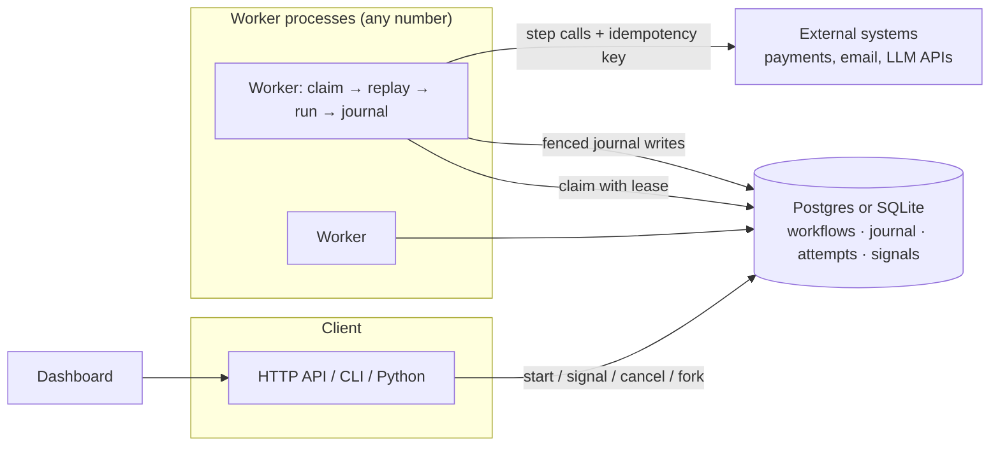

# Ninelives architecture

Ninelives runs Python workflows, including LLM agents, so that they survive crashes. If a worker is killed at any point (`kill -9`, OOM, a deploy), another worker resumes the workflow from its last completed step. Finished steps are not re-run, LLM calls are not re-billed, and side effects carry idempotency keys so external systems can drop the rare duplicate.

The design follows the "durable execution" family (Temporal, DBOS, Restate, Inngest), built small enough to read in an afternoon.

## Goals and non-goals

| Goal | How |
| --- | --- |
| Survive any crash | Every completed step is journaled in the database before the next one starts; recovery replays the journal. |
| No split-brain | Workers hold expiring leases with a fencing token; every write checks the token in the same transaction. |
| Effectively-once side effects | Steps are at-least-once; each step gets a stable idempotency key (`workflow_id:seq`) for the systems it calls. |
| Long waits cost nothing | `sleep` and `wait_for_signal` suspend the workflow in the database; no process holds it in memory. |
| Agents that resume | Each LLM call and each tool call is a step, so a crashed agent resumes mid-conversation without paying for the same tokens twice. |
| Humans in the loop | Risky tool calls wait for an approval signal sent from the API or dashboard. |
| Observable | Every run, step, attempt and signal is queryable; a dashboard shows timelines, retries and pending approvals. |

Non-goals for v1: multi-region replication, sub-millisecond latency, child workflows, cron schedules, a workflow versioning system beyond non-determinism detection.

## Components

- **`Ninelives` app:** the registry of workflows and steps, plus client operations (start, signal, cancel, fork, result).
- **Store:** all durable state. Two implementations share one contract and one test suite: `SQLiteStore` (single machine; WAL; works across processes) and `PostgresStore` (asyncpg; `FOR UPDATE SKIP LOCKED` claiming).
- **Worker:** polls the store, claims runnable workflows with a lease, executes them, heartbeats, and records outcomes.
- **WorkflowContext:** the deterministic replay machinery inside a running workflow.
- **Agents:** a durable tool-calling loop over any LLM provider (Anthropic, OpenAI-compatible, or a scripted fake for tests).
- **Server:** FastAPI endpoints and a React dashboard.

## Data model

| Table | Key fields | Purpose |
| --- | --- | --- |
| `workflows` | `id`, `name`, `status`, `input`, `output`, `error`, `wake_at`, `lease_token`, `lease_expires_at`, `runs`, `recoveries`, `cancel_requested`, `forked_from` | One row per workflow run |
| `journal` | `(workflow_id, seq)`, `kind`, `name`, `status`, `output`, `error`, `wake_at`, `attempts` | The ordered record of durable operations |
| `attempts` | `workflow_id`, `seq`, `attempt`, `worker`, `started_at`, `finished_at`, `error` | Every step execution, including failed retries and ones lost to crashes |
| `signals` | `id`, `workflow_id`, `name`, `payload`, `consumed_seq` | Messages into a workflow (approvals, events) |

Statuses: `PENDING → RUNNING → (WAITING ⇄ RUNNING)* → SUCCEEDED | FAILED | CANCELLED`.

## Execution model: replay

A workflow is an ordinary `async def` function. Each durable operation it performs gets the next sequence number (`seq`):

| Operation | First execution | On replay |
| --- | --- | --- |
| `await my_step(...)` / `ctx.step(fn, ...)` | Run with retries; journal output or final error | Return the journaled output (or re-raise the journaled error) without running |
| `ctx.sleep(s)` | Journal a timer with `wake_at`; suspend | Continue if `wake_at` has passed, else suspend again |
| `ctx.wait_for_signal(name, timeout)` | Journal a wait; consume a matching signal if one already arrived, else suspend | Return the consumed payload, or raise `SignalTimeout` |
| `ctx.now()`, `ctx.uuid()`, `ctx.random()` | Journal the value | Return the journaled value |

When a worker picks a workflow up, it re-runs the function from the top. Completed operations return instantly from the journal, so execution fast-forwards to the first unfinished operation. This is why workflow code must be deterministic. Anything non-deterministic (I/O, time, randomness) must go through a step or a context helper.

**Determinism check.** Each journal entry stores the operation's kind and name. If replay reaches `seq` 3 expecting `step:charge_card` but the code now calls `step:send_email`, the workflow fails with `NonDeterminismError` instead of silently corrupting state.

**Suspension.** `sleep` and `wait_for_signal` raise an internal `Suspend`. The worker catches it, stores `status=WAITING` with the earliest `wake_at` (or none, for waits without a timeout), and releases the lease. Sending a signal sets `wake_at = now` so the workflow is picked up immediately.

## Leases and fencing

1. **Claim.** A worker atomically moves one or more runnable workflows to `RUNNING` and sets a fresh random `lease_token` plus `lease_expires_at = now + ttl`. A workflow is runnable when it is `PENDING`, or `WAITING` with `wake_at ≤ now`, or `RUNNING` with an expired lease (its worker died). Postgres uses `FOR UPDATE SKIP LOCKED`; SQLite uses `BEGIN IMMEDIATE`.
2. **Heartbeat.** While running, the worker extends `lease_expires_at` every `ttl / 3`. If the update matches no row, the lease was lost and the worker cancels its execution.
3. **Fencing.** Every write a worker makes for a workflow (journal entries, signal consumption, completion, suspension) runs in a transaction that first checks `lease_token = mine`. A worker that was paused (GC, network partition) and lost its lease cannot write after another worker took over; it gets `LeaseLost` and abandons the run.
4. **Recovery.** When a lease expires, the next claim increments `recoveries` and the new worker replays from the journal.

Clocks: lease expiry compares worker clocks. Leases are seconds long, so NTP-level skew is harmless. Fencing does not depend on clocks at all.

## Guarantees

- **Workflow code:** may run many times (replay), and must be deterministic.
- **Steps:** at least once. A step can run again only if its worker dies after the step's side effect but before the journal write. Each attempt is recorded in `attempts`.
- **Effectively once:** steps read `step_info().idempotency_key`, which is stable across retries and recoveries (`{workflow_id}:{seq}`). Pass it to payment APIs, email providers or your own tables to deduplicate. The chaos test proves exactly-once effects this way.
- **Signals:** delivered once. Consuming a signal and journaling it happen in one fenced transaction.
- **Retries:** per-step policy (attempts, exponential backoff with jitter, timeout, non-retryable errors). Attempt counts persist across crashes, so `max_attempts` is respected even after recovery.

## Agents

An agent is a workflow registered as `agent:<name>`. Each turn has two kinds of step:

1. An `llm` step sends the conversation and tool schemas to the provider. The normalised response, with token usage, is journaled, so recovery never repeats a paid call.
2. For each tool call, a `tool:<name>` step runs the Python function with its own idempotency key. Tools listed in `approval_required` first wait for a signal `approval:<call_id>` (`{"approved": true|false, "note": ...}`) with a timeout. A denial is reported back to the model as the tool result.

Budgets stop the loop: maximum turns and maximum total tokens. Tool schemas are generated from Python signatures and docstrings. Providers convert between a neutral message format and the Anthropic Messages API or OpenAI-compatible chat completions; `ScriptedLLM` replays fixed responses for tests and demos.

## HTTP API

| Method | Path | Purpose |
| --- | --- | --- |
| `POST` | `/api/workflows/{name}` | Start (body `{"args": [], "kwargs": {}, "id": optional}`); idempotent when `id` is given |
| `GET` | `/api/workflows` | List with `status`, `name`, `limit`, `offset` |
| `GET` | `/api/workflows/{id}` | Detail: record, journal, attempts, signals |
| `POST` | `/api/workflows/{id}/signals/{name}` | Send a signal (body = payload) |
| `POST` | `/api/workflows/{id}/cancel` | Request cancellation |
| `POST` | `/api/workflows/{id}/fork` | Copy the journal up to `from_seq` into a new run and re-execute from there |
| `GET` | `/api/stats` | Counts by status, registered workflows |

## Testing strategy

| Layer | What it proves |
| --- | --- |
| Store contract tests, run against SQLite and Postgres | Claiming, fencing, signals and suspension behave identically on both backends |
| Engine tests | Replay, retries, timers, signals, cancellation, fork, non-determinism detection, serialization |
| Concurrency tests | Many workers, no workflow executed by two workers at once, no lost workflows |
| Fencing test | A paused worker whose lease was taken cannot write |
| Chaos test | Worker processes are `SIGKILL`ed at random while 50+ workflows run; all finish, the external ledger holds each effect exactly once, and the journal has no gaps |
| Agent tests | Tool loop, approvals, denials, budgets, resume without repeating LLM calls, provider message conversion |
| API and dashboard | Endpoints and a browser test of the dashboard against a live server |
