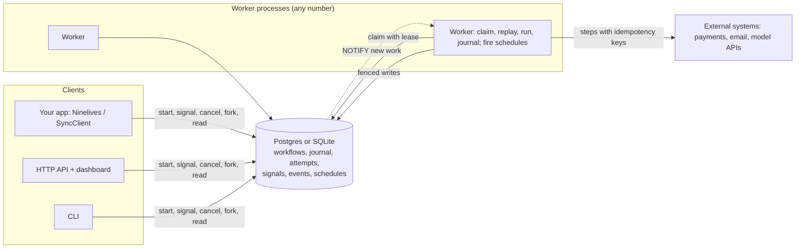

# Ninelives architecture

Ninelives runs Python workflows, including AI agents, so that they survive crashes. If a worker is
killed at any point (`kill -9`, an out-of-memory error, a deploy), another worker resumes the run
from its last completed step. Finished steps are not re-run, model calls are not paid for twice, and
side effects carry idempotency keys so external systems can drop the rare duplicate.

The design follows the durable-execution family (Temporal, DBOS, Restate, Inngest), kept small
enough to read in an afternoon. This document explains how it works; the [user guide](guide/) explains
how to use it.

## Goals and non-goals

| Goal | How |
| --- | --- |
| Survive any crash | Every completed operation is journaled before the next starts; recovery replays the journal. |
| No split-brain | Workers hold expiring leases with a fencing token; every write checks the token in the same transaction. |
| Effectively-once side effects | Steps are at least once; each gets a stable idempotency key (`<run id>:<position>`) for the systems it calls. |
| Long waits cost nothing | Timers, signal waits and child waits park the run in the database; no process holds it. |
| Composable | Child workflows, messages between runs and published events. |
| Operable | Schedules, concurrency limits, priority, timeouts, retention, migrations, metrics and tracing. |
| Agents that resume | Each model call and tool call is a step; risky tools wait for a human approval. |

Non-goals: a separate server process or wire protocol (it is a library), multi-region replication,
sub-millisecond latency, worker-version pinning.

## Components

| Module | Responsibility |
| --- | --- |
| `app.py` | Registry of workflows, steps and schedules; client operations (start, result, signal, cancel, fork, describe, events, schedules, purge). |
| `context.py` | `WorkflowContext`: replay, steps and retries, timers, signals, children, sends, events, `patched`, `gather`, deterministic values. |
| `worker.py` | Claiming with leases, heartbeats, executing runs, recording outcomes, firing schedules, retention. |
| `stores/sql.py` | Every store operation, written once as a transaction script; schema migrations. |
| `stores/sqlite.py`, `stores/postgres.py` | Drivers that run transaction scripts: placeholders, row locks, advisory locks, notifications. |
| `cron.py` | Five-field cron evaluation in a time zone. |
| `agents/` | The agent loop, tool schemas, model providers (Anthropic, OpenAI-compatible, scripted). |
| `server/`, `cli.py` | FastAPI app (API, metrics, dashboard) and the command line. |
| `testing.py`, `sync.py`, `tracing.py` | Test environment with a fake clock, synchronous client, OpenTelemetry spans. |

## Data model

| Table | Key columns | Purpose |
| --- | --- | --- |
| `workflows` | `id`, `name`, `status`, `input`, `output`, `error`, `wake_at`, `waiting_for`, `lease_token`, `lease_owner`, `lease_expires_at`, `runs`, `recoveries`, `cancel_requested`, `forked_from`/`fork_seq`, `parent_id`/`parent_seq`, `priority`, `concurrency_key`, `deadline`, `schedule_id` | One row per run |
| `journal` | `(workflow_id, seq)`, `kind`, `name`, `status`, `output`, `error`, `wake_at`, `attempts` | The ordered record of durable operations |
| `attempts` | `(workflow_id, seq, attempt)`, `worker`, `started_at`, `finished_at`, `error` | Every step execution, including failed retries and ones lost to crashes |
| `signals` | `id`, `workflow_id`, `name`, `payload`, `consumed_seq`, `dedupe_key` | Messages into a run (approvals, child results, sends) |
| `events` | `(workflow_id, key)`, `value`, `updated_at` | Values a run publishes |
| `schedules` | `id`, `workflow`, `cron`, `tz`, `input`, `overlap`, `enabled`, `next_at`, `last_at`, `last_run_id`, `seen_at` | Cron schedules and their firing state |
| `ninelives_schema` | `version` | Applied migrations |

Run statuses: `PENDING → RUNNING → (WAITING ⇄ RUNNING)* → SUCCEEDED | FAILED | CANCELLED`.

## Execution model: replay

A workflow is an ordinary `async def`. Each durable operation it performs takes the next position
(`seq`) in the journal:

| Operation | First execution | On replay |
| --- | --- | --- |
| step | run with retries; journal the output or final error | return the journaled output, or re-raise the journaled error |
| `ctx.sleep` | journal a timer; suspend if longer than 1 s | continue if due, otherwise suspend again |
| `ctx.wait_for_signal` | journal a wait; take a matching signal or suspend | return the consumed payload, or raise `SignalTimeout` |
| `ctx.start_child` | create the child and journal its id, in one transaction | return the journaled id |
| `ctx.wait_child` | a signal wait on `child:<id>` | as above |
| `ctx.send` | insert the signal and journal the send, in one transaction | nothing |
| `ctx.set_event` | upsert the event and journal it, in one transaction | nothing |
| `ctx.now / uuid / random` | journal the value | return it |
| `ctx.patched(id)` | journal a marker; return True | True at the marker, False where an older run did something else |

When a worker picks a run up, it calls the function from the top. Operations in the journal return
instantly, so execution fast-forwards to the first unfinished one. Workflow code must therefore be
deterministic; I/O, time and randomness go through steps or `ctx` helpers.

**Determinism check.** Each journal entry stores its kind and name. If a replay at position 3 expects
`step:charge` but the code now calls `step:email`, the run fails with `NonDeterminismError` rather
than continuing on a mismatched history. Patch markers are skipped when the code no longer asks for
them, so retired `patched()` calls replay cleanly.

**Suspension.** Long sleeps and waits raise an internal `_Suspend`. The worker stores
`status = WAITING`, the earliest `wake_at` (capped at the run's deadline), the signal names awaited,
and releases the lease. A signal wakes a waiting run only if the run waits for that name. Suspension
also checks for matching signals that arrived while the run was executing, so none are lost.

**Concurrency inside a workflow.** Positions must not depend on timing. `asyncio.gather` over single
steps is safe, because each takes its position when its task starts, in argument order.
`ctx.gather` runs multi-step branches with round-robin position allocation. A branch parked on a
sleep or signal keeps its turn, so its siblings pause at their next durable call, and the run
suspends until the earliest wake-up. A raw `asyncio.gather` branch that makes a second durable call
fails loudly instead.

## Leases, fencing and recovery

1. **Claim.** In one transaction, a worker moves runnable runs to `RUNNING`, with a fresh random
   `lease_token` and `lease_expires_at = now + ttl`. Runnable means `PENDING`, `WAITING` with
   `wake_at <= now`, or `RUNNING` with an expired lease (its worker died). Order: `priority DESC`,
   then due time. Postgres uses `FOR UPDATE SKIP LOCKED`; SQLite uses `BEGIN IMMEDIATE`.
2. **Concurrency limits** are checked in the same transaction. Postgres takes an advisory transaction
   lock per limited workflow name, so two claimers cannot both see a free slot; only live runs
   (`RUNNING` with an unexpired lease) count.
3. **Heartbeat.** The worker extends the lease every `ttl / 3`. If the update matches no row, the
   lease is gone and the worker cancels that execution.
4. **Fencing.** Every write for a run checks `lease_token = mine` in the same transaction. This covers
   attempts, journal entries, events, child starts, sends, completion and suspension. A worker that
   was paused and lost its lease gets `LeaseLost` and abandons the run. A worker that re-claims a run
   it was still executing stops the stale execution first.
5. **Recovery.** When a lease expires, the next claim increments `recoveries`, and the new worker
   replays from the journal.

Clocks matter only for lease expiry, which is measured in seconds, so normal clock skew is harmless.
Fencing does not depend on clocks.

## Steps and retries

Each attempt is recorded in `attempts` *before* the step runs, so attempt counts survive crashes and
`max_attempts` holds across recoveries. A successful step closes its attempt and journals its output
in **one** transaction. Failed attempts are closed with their error and retried after an exponential,
jittered delay. `PermanentError` and `non_retryable` types fail at once. Output is serialised to JSON
and read back before the workflow sees it, so the first execution and every replay see identical
values.

## Child workflows

`start_child` creates the child row (with `parent_id` and `parent_seq`) and journals its id in one
fenced transaction on the parent. When a child reaches a terminal status, the same transaction
inserts a signal `child:<id>` carrying `{status, output, error}` into the parent and wakes it.
`wait_child` is a signal wait, so it is durable, free while waiting, and needs no polling.
Cancellation walks the tree, cancelling all unfinished descendants. Forks of a parent hand over the
results of finished children whose waits come after the fork point.

## Schedules

`app.schedule(...)` declares a schedule in code. Workers upsert their declared schedules when they
start (the code is the source of truth) and, about once a second, run `fire_schedules`. That claims
due rows with `FOR UPDATE SKIP LOCKED` (SQLite: `BEGIN IMMEDIATE`), creates the run
`<schedule>@<tick>` and advances `next_at`, all in one transaction. So exactly one run starts per
tick, and the run id makes the start idempotent as well.

- **After downtime**, only the most recent missed tick runs.
- **Overlap.** `overlap="skip"` advances past a tick while the previous run is unfinished.
- **Declared only.** Workers fire only schedules their code declares.

Cron evaluation (`cron.py`) walks local wall-clock time in the schedule's zone, so DST gaps are
skipped and repeated hours fire once.

## Stores, migrations and notifications

Every store operation is a **transaction script**: a generator that yields SQL statements (with `?`
placeholders and markers such as `/*FOR_UPDATE*/`), lock requests and notification requests, and
receives their results. The SQLite driver runs a whole script inside its worker thread in one
`BEGIN IMMEDIATE` transaction, one thread hop per transaction. The Postgres driver runs it on an
asyncpg connection, translates placeholders and locking markers, and retries the script on deadlock
or serialization failure. Behaviour is therefore identical on both backends, and one contract test
suite checks it.

`MIGRATIONS` in `stores/sql.py` is an append-only list of schema versions. `Store.init()` takes a
lock (an advisory lock on Postgres, `BEGIN IMMEDIATE` on SQLite), reads `ninelives_schema`, and
applies any missing versions in the same transaction. A database from v0.1, which has tables but no
version table, is recognised as version 1 and upgraded in place. A database from a newer version is
refused.

New work (a start, a woken run, a schedule firing, a released lease) triggers a notification after
commit: `pg_notify` on Postgres, and an in-process wake-up for workers sharing the store object.
Idle workers wait on notifications *or* their poll interval, whichever comes first.

## Agents

An agent is a workflow named `agent:<name>`. Each turn:

1. **The model step.** `agent:<name>:llm` sends the conversation and tool schemas to the model
   provider. The response, normalised into neutral content blocks and including token usage, is
   journaled, so recovery never repeats a paid call.
2. **The tool steps.** For each tool call, `tool:<name>` runs the Python function with its own
   idempotency key. A tool with `requires_approval=True` first waits for the signal
   `approval:<call_id>`, and a timeout counts as a denial. These are reported back to the model as
   `is_error` results so it can recover: denials, unknown tools, arguments that do not match the
   signature, and tools that fail after their retries.

Further rules:

- **One reply per turn.** All tool results of a turn go back in one message.
- **Blocks round-trip unchanged.** Assistant content blocks are appended exactly as received, so
  provider-specific blocks survive.
- **Stopping.** The loop stops on budgets (`max_turns`, `max_total_tokens`) and on refusals.
- **Optional extras.** Agents can publish an `agent` progress event after each turn, and run one
  turn's tools concurrently with `ctx.gather`.

The providers:

- **`OpenAICompatibleLLM`** converts the neutral shape to and from chat-completions messages over
  HTTP.
- **`AnthropicLLM`** uses the official SDK.
- **Error handling is the same for both.** Request and authentication errors become
  `PermanentError` (no retry). Rate limits, 5xx responses and network errors are retried by the
  step's policy.

## Guarantees

- **Workflow code** may run many times (replay) and must be deterministic.
- **Steps** run at least once. A step runs again only if its worker dies after the step's side effect
  and before the journal write.
- **Effectively once.** `step_info().idempotency_key` is stable across retries and recoveries.
  The chaos tests prove exactly-once effects through such a key.
- **Signals, sends and child results** are delivered exactly once, in order. Consuming a signal and
  journaling it happen in one fenced transaction.
- **Schedules** start exactly one run per tick.
- **Retries** respect `max_attempts` across crashes.

## Testing strategy

| Layer | What it proves |
| --- | --- |
| Store contract tests (SQLite in memory, SQLite file, Postgres) | Claiming, fencing, signals, suspension, events, children, cancellation trees, limits, schedules, purge, migrations and notifications behave identically on every backend |
| Engine tests | Replay, retries, timers, signals, cancellation, fork, non-determinism detection, `gather`, `patched`, children, sends, events, timeouts, limits, priority, schedules, retention |
| Fencing and race tests | A paused worker cannot write after losing its lease; a worker re-claiming its own run stops the stale execution; `run_until_idle` cannot stop early; concurrent SQLite opens |
| Chaos tests | Real worker processes `SIGKILL`ed and `SIGSTOP`ped at random: 80 workflows, and 20 parents fanning out to 60 children, on SQLite and Postgres; each side effect lands exactly once in an external ledger |
| Agent and provider tests | Tool loop, approvals, timeouts, budgets, refusal, resume without repeated model calls, progress events, parallel tools; request and response mapping for both providers |
| API, CLI, testing helpers, sync client, tracing | Every endpoint and error code, every command, `TestEnv`, `SyncClient` from plain threads, span structure |
| Dashboard | Playwright against live servers: runs, signals, approvals, forks, cancel, schedules, children, progress, search, sign-in, mobile layout |
| Docker | `docker compose` brings up Postgres, the server and workers, and runs a workflow end to end |

## Known limitations

- **Effects need idempotency keys.** Steps are at least once; exactly-once effects need the
  idempotency key to reach the external system.
- **Sync step timeouts.** A synchronous (`def`) step that times out keeps running in its thread
  until it returns.
- **Code changes are detected, not migrated.** Changing workflow code under in-flight runs is
  detected rather than migrated; use `ctx.patched`, drain first, or fork after the fix.
- **Parked branches pause their siblings.** Inside `ctx.gather`, a branch parked on a long wait
  pauses its siblings at their next durable call.
- **SQLite is one machine only.** SQLite workers share one machine and poll for new work; use
  Postgres for several hosts and instant pickup.
- **The `recoveries` counter** also counts the handover after a graceful shutdown.
